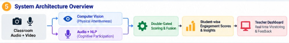
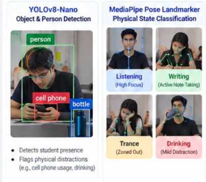

# Multimodal Real-Time Classroom Engagement and Attentiveness Monitoring System

## Overview

This repository provides an end-to-end, multimodal artificial intelligence framework designed to monitor and evaluate student attentiveness and cognitive engagement during live classroom lectures. 

The system fuses two asynchronous streams in real time:
1. **Computer Vision Stream (Physical Attentiveness - 60% Weight)**: Tracks physical postures, eye/head orientation, active note-taking, drinking, and device distractions using YOLOv8, MediaPipe Pose Landmarkers, and 128-dimensional facial recognition.
2. **Audio and NLP Stream (Cognitive Participation - 40% Weight)**: Captures student speech, performs automatic speech recognition (ASR) with Whisper, classifies pedagogical dialogue acts using the SSCon framework (DialoGPT + Sentence-BERT + Bi-Encoder + XGBoost), and verifies semantic relevance against lecture material via an embedding-based Relevance Gateway.

---

## System Architecture



```
+-----------------------------------------------------------------------------+
|                               session_runner.py                             |
|               (Asynchronous Multi-Threaded Central Coordinator)             |
+------------------------------------+----------------------------------------+
                                     |
         +---------------------------+---------------------------+
         |                                                       |
         v                                                       v
+---------------------------------+     +-------------------------------------+
|    Computer Vision Pipeline     |     |        Audio & NLP Pipeline         |
|                                 |     |                                     |
|  * YOLOv8-nano (Person/Object)  |     |  * Noise Filtering & VAD            |
|  * Face Recognition (128D dlib) |     |  * OpenAI Whisper ASR               |
|  * MediaPipe 3D Pose Landmarks  |     |  * SSCon Dialogue Act Classifier    |
|  * Geometric Pose Classifier    |     |  * Semantic Relevance Gateway       |
|    (listen, write, drink, trance|     |    (Sentence-BERT Cosine Sim)       |
+----------------+----------------+     +------------------+------------------+
                 |                                         |
                 v                                         v
         attentiveness_log.csv                     sscon_output.json
                 |                                         |
                 +--------------------+--------------------+
                                      |
                                      v
                      +-------------------------------+
                      |   Double-Gated Fusion Engine  |
                      |                               |
                      |  * CV Weight: 60%             |
                      |  * Audio Weight: 40%          |
                      |  * +4 On-Topic / -2 Off-Topic |
                      |  * Behavioral Feedback Synth  |
                      +---------------+---------------+
                                      |
                                      v
                      Final Student Attentiveness Report
```

---

## Pipeline Components

### 1. Computer Vision Pipeline



* **YOLOv8-Nano**: Detects the student bounding box and identifies classroom distractions, including mobile phones and drink containers.
* **Face Recognition**: Matches the detected student against pre-registered images in `face_data/` using deep 128-dimensional facial encodings with temporal identity persistence.
* **MediaPipe Pose Landmarker**: Tracks 33 body keypoints in real time to calculate geometric angles (ear-nose ratio, shoulder-nose drop) and categorize physical state:
  * `listen`: Focused gaze directed toward the instructor/screen (4 points per window).
  * `write`: Active note-taking indicated by downward head pitch and pen interaction (5 points per window).
  * `drink`: Mild physical distraction (1 point per window).
  * `trance`: Passive gaze aversion or head rested on desk (0 points per window).

### 2. Audio & NLP Pipeline

* **Speech-to-Text**: Employs OpenAI Whisper (`small.en`) streaming raw audio directly from memory. Primed with an `initial_prompt` containing domain vocabulary from `subject.txt` to eliminate speech recognition hallucinations.
* **SSCon Dialogue Act Classifier**:
  * **DialoGPT-medium**: Encodes multi-turn conversational context (1024 dimensions).
  * **Sentence-BERT (`all-MiniLM-L6-v2`)**: Encodes the current utterance (384 dimensions).
  * **Bi-Encoder Neural Network**: Projects concatenated features into a unified 384-dimensional latent embedding.
  * **XGBoost**: Predicts the pedagogical dialogue act (*Relating to another student*, *Asking for more information*, *Making a claim*, *Providing evidence*).
* **Semantic Relevance Gateway**: Evaluates spoken statements against the lecture reference text in `subject.txt` using Sentence-BERT embeddings. Statements achieving a cosine similarity above threshold are classified as **On-Topic**; conversational noise and unrelated chatter are categorized as **Off-Topic**.

### 3. Double-Gated Scoring Formula

* **Utterance-Level Audio Scoring**:
  $$\text{Net Points} = (\text{On-Topic Utterances} \times 4) - (\text{Off-Topic Utterances} \times 2)$$
  $$\text{Dialogue Score (\%)} = \frac{\max(0, \text{Net Points})}{\text{Total Utterances} \times 4} \times 100$$
* **Multimodal Grade Fusion**:
  $$\text{Final Engagement Score} = (\text{CV Attentiveness \%} \times 0.60) + (\text{Dialogue Score \%} \times 0.40)$$
* **Automated Teacher Feedback**: Synthesizes student behavioral profiles (*Strong Analytical Skills*, *Highly Inquisitive*, *Passive Participant*, *Distracted Speaker*, *Silent Observer*).

---

## Installation

### Prerequisites
* Python 3.10 to 3.13
* Web camera and functional microphone

### Setup Environment
```bash
git clone https://github.com/your-username/AI-EdTech-Project.git
cd AI-EdTech-Project

# Create and activate virtual environment
python -m venv venv
# On Windows:
.\venv\Scripts\activate
# On Linux/macOS:
source venv/bin/activate

# Install dependencies
pip install -r requirements.txt
```

---

## How to Run

### Step 1: Add Student Photos
Place clear, front-facing photos of registered students in the `face_data/` directory. Name each file after the student:
```
face_data/
  ├── Karan.jpg
  └── Siddharth.png
```

### Step 2: Subject Material Setup
The repository includes a reference lecture in `subject.txt` covering **Gravity and Universal Gravitation**. 

If you wish to test with a different topic (e.g. History, Mathematics, Chemistry), simply replace the text in `subject.txt` with your lecture summary.

### Step 3: Start the Live Session
```bash
python session_runner.py
```

1. The script will initialize ML models into memory and launch the video and microphone capture loops.
2. When `SESSION IS LIVE  Camera + Microphone active!` appears, the webcam feed will open with live bounding boxes and posture labels.
3. To end the session and generate the final diagnostic report, press **ESC** in the camera window or press **Ctrl+C** in the terminal.

---

## Demonstration Test Scripts

You can test both ends of the scoring spectrum using the pre-loaded `subject.txt` (Gravity lesson):

### Test Scenario A: Attentive Student (Target Score: 90 - 100 / 100)
1. **Camera**: Face the camera upright (`listen`) or look down as if writing notes (`write`).
2. **Microphone**: Read the following lines with a brief 2-second pause between them:
   * **Line 1**: *"Objects with greater mass have a much stronger gravitational pull on other objects."*
   * **Line 2**: *"If the distance between two planets increases, the gravitational attraction between them becomes much weaker."*
   * **Line 3**: *"Earth's gravity pulls all objects toward its center, which is what keeps us on the ground."*

### Test Scenario B: Inattentive / Distracted Student (Target Score: 0 - 20 / 100)
1. **Camera**: Turn your head away from the screen or rest your head on your hand (`trance`), or hold a bottle/cup (`drink`).
2. **Microphone**: Speak off-topic lines:
   * **Line 1**: *"I am ordering a large pepperoni pizza and burger for lunch."*
   * **Line 2**: *"Let us go play video games and watch a movie after this class."*
   * **Line 3**: *(Remain completely silent for the remainder of the session)*

---

## Citation

```bibtex
@inproceedings{Kumaran-etal-2023-sscon,
    title = "Improving Classroom Dialogue Act Recognition from Limited Labeled Data with Self-Supervised Contrastive Learning Classifiers",
    author = "Kumaran, Vikram and
    Rowe, Jonathan and
    Mott, Bradford and
    Chaturvedi, Snigdha and
    Lester, James",
    booktitle = "Findings of the Association for Computational Linguistics: ACL 2023",
    year = "2023",
    publisher = "Association for Computational Linguistics",
}
```
