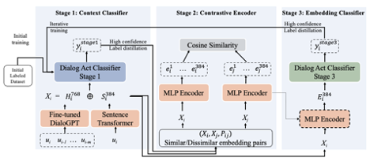

## Improving Classroom Dialogue Act Recognition from Limited Labeled Data with Self-Supervised Contrastive Learning Classifiers
### Authors
Vikram Kumaran, Jonathan Rowe, Bradford Mott, Snigdha Chaturvedi and James Lester

### Abstract
Recognizing classroom dialogue acts has significant promise for yielding insight into teaching, student learning, and classroom dynamics. However, obtaining K-12 classroom dialogue data with labels is a significant challenge, and therefore, developing data-efficient methods for classroom dialogue act recognition is essential. This work addresses the challenge of classroom dialogue act recognition from limited labeled data using a contrastive learning-based selfsupervised approach (SSCon). SSCon uses two independent models that iteratively improve
each other's performance by increasing the accuracy of dialogue act recognition and minimizing the embedding distance between the same dialogue acts. We evaluate the approach on three complementary dialogue act recognition datasets: the TalkMoves dataset (annotated K-12 mathematics lesson transcripts), the DailyDialog dataset (multi-turn daily conversation dialogues), and the Dialogue State Tracking Challenge 2 (DSTC2) dataset (restaurant reservation dialogues). Results indicate that our selfsupervised contrastive learning-based model outperforms competitive baseline models when trained with limited examples per dialogue act. Furthermore, SSCon outperforms other fewshot models that require considerably more labeled data. 

This project is an implementation of the approach.

### Model



### Installation
Python 3.6 or later is needed to run the scripts. The following Python packages are also needed:
* numpy==1.23.4
* pandas==1.5.0
* pytorch_lightning==2.0.2
* scikit_learn==1.2.2
* torch==1.12.1
* tqdm==4.64.1
* xgboost==1.7.5


## Usage
```python main.py```

This script accepts no command-line arguments. It uses hardcoded data paths to load pickled pandas DataFrames representing the training, validation, and test datasets.

## Inputs
The script takes as input the following data:

* __unlabeled_train_df__: An unlabeled training dataset. Pandas dataframe with just the featureCol.
* __labeled_train_df__: A labeled training dataset. Pandas dataframe with two columns. The featureCol and labelCol.
* __val_df__: A validation dataset. Pandas dataframe with two columns. The featureCol and labelCol.
* __test_df__: A test dataset. Pandas dataframe with two columns. The featureCol and labelCol.

The data should be in pickled Pandas DataFrame format. Each DataFrame should contain a columnfor features and a column for labels (in the case of labeled data).

## Outputs
The script outputs the performance metrics of the trained SSCon on the test dataset.

## Code Structure
The code first sets up the environment, then loads the data. It next performs Semi-Supervised Contrastive Learning with the function SSCon_run. After this, it prints the performance of the XGBoost classifier on the test data.

## Additional Information
The SSCon_run function requires additional parameters such as biencoder_path, biencoder_epoch, iteration_cnt, and others. Make sure these parameters are correctly set according to your application. The XGBoost classifier model is also loaded from a pre-defined path, ensure the model exists at the mentioned path.

## Citation
```
@inproceedings{Kumaran-etal-2023-sscon,
    title = "Improving Classroom Dialogue Act Recognition from Limited Labeled Data with Self-Supervised Contrastive Learning Classifiers",
    author = "Kumaran, Vikram and
    Rowe, Jonathan and
    Mott, Bradford and
    Chaturvedi, Snigdha and
    Lester, James",
    booktitle = "Findings of the Association for Computational Linguistics: ACL 2023",
    year = "2023",
    publisher = "Association for Computational Linguistics",
}
```
